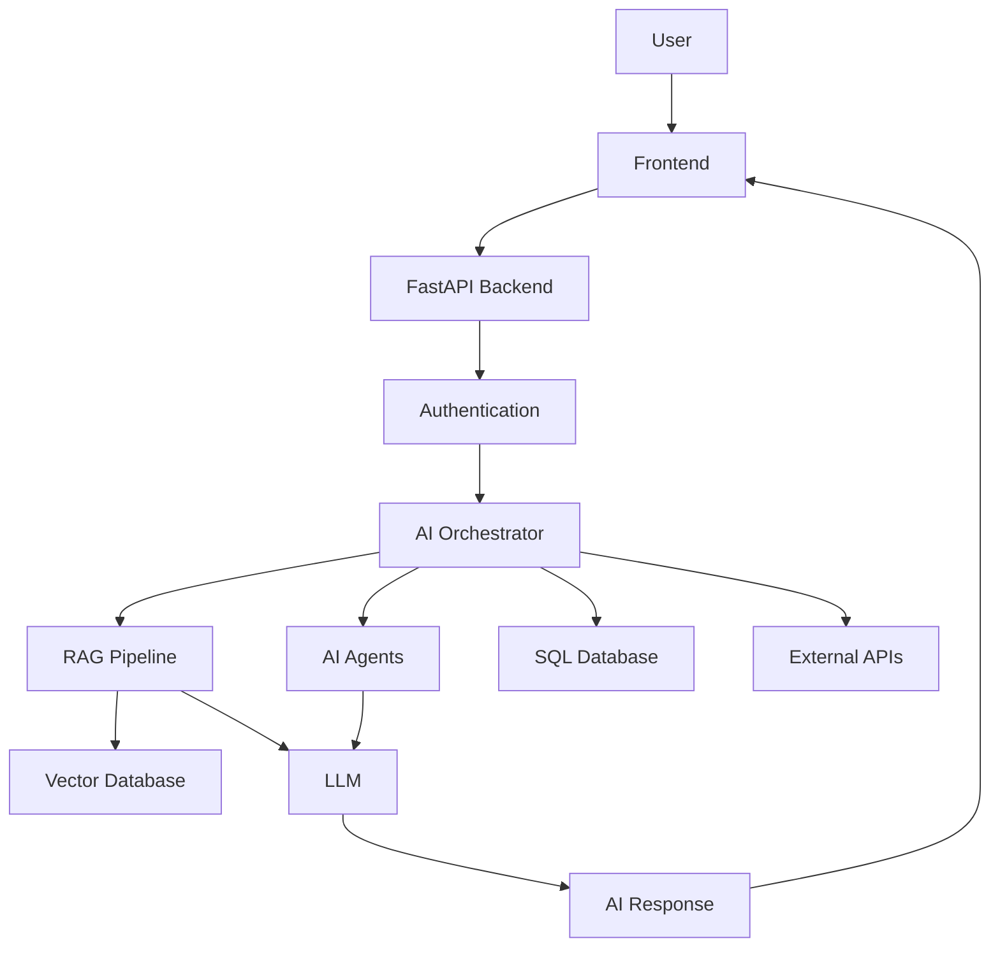

# SYSTEM ARCHITECTURE

## 1. Architecture Overview

The ENTERPRISE AI PLATFORM follows a modular architecture designed to support enterprise-level AI applications.

The system is divided into three primary layers:

1. Frontend Layer
2. Backend Layer
3. AI Engine and Data Layer

These layers communicate with each other to process user requests, retrieve enterprise information, execute AI-powered workflows, and generate intelligent responses.

## 2. Frontend Layer

The Frontend Layer provides the user interface through which users interact with the platform.

Responsibilities:

- User interaction.
- Document uploads.
- Query submission.
- Displaying AI-generated responses.
- Showing workflow status.
- Displaying reports and analytics.

Planned Technology:

- HTML
- CSS
- JavaScript
- React (planned)

## 3. Backend Layer

The Backend Layer manages application logic and communication between the frontend, AI engine, and databases.

Responsibilities:

- API management.
- Request processing.
- Authentication and authorization.
- Database communication.
- AI service integration.
- Workflow management.

Planned Technology:

- Python
- FastAPI
- SQL

## 4. AI Engine Layer

The AI Engine is responsible for intelligent processing and automation.

Major Components:

### 4.1 LLM Integration

Connects Large Language Models to understand queries and generate responses.

### 4.2 RAG Pipeline

Retrieves relevant information from enterprise documents and provides context to LLMs.

### 4.3 AI Agent System

Uses specialized AI agents to perform different business tasks.

### 4.4 Multi-Agent Orchestration

Coordinates multiple AI agents to solve complex enterprise problems.

### 4.5 AI Evaluation

Evaluates response quality, accuracy, and reliability.

## 5. Data Layer

The Data Layer manages structured and unstructured enterprise information.

Planned Components:

- SQL Database
- Vector Database
- Document Storage

Responsibilities:

- Store business information.
- Manage uploaded documents.
- Store vector embeddings.
- Support information retrieval.

## 6. External Integrations

The platform will integrate with external services through APIs.

Examples:

- LLM APIs.
- Enterprise applications.
- External business services.

## 7. Security Layer

Security mechanisms will protect enterprise information and system operations.

Planned capabilities:

- Authentication.
- Authorization.
- Role-Based Access Control.
- Secure API communication.
- Audit logging.

## 8. Architecture Design Principles

- Modular design.
- Scalability.
- Security.
- Maintainability.
- Reliability.
- Extensibility.

**Document Status:** Initial Architecture Defined

